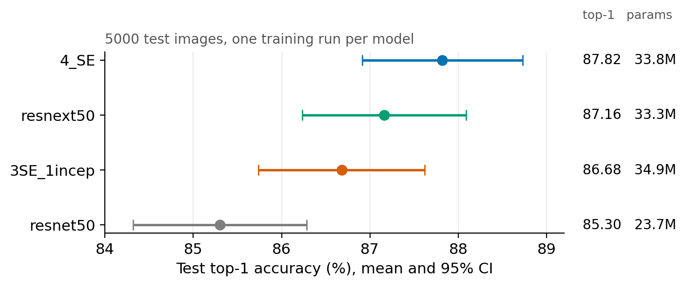
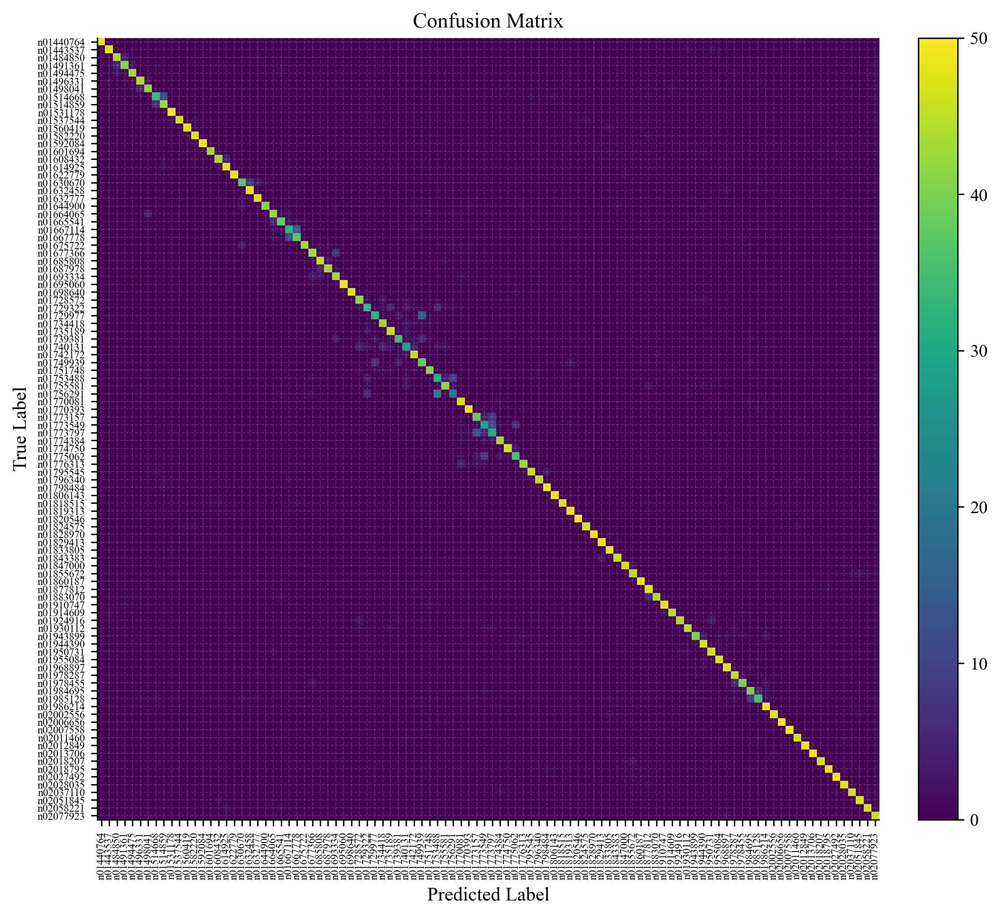

# ImageNet-100 上的 ResNet-50 变体对比：通道注意力、Inception 与分组卷积

在 ImageNet-100（100 类）上从零训练 ResNet-50 及三个改进变体，在独立的官方验证集（5000 张）上评估。最好的变体 `4_SE`（每个 Bottleneck 都加入通道注意力）test top-1 为 **87.82%**，baseline 为 85.30%。

全部代码基于 PyTorch，数据加载、训练、评估、可视化均为自己实现。

## 结果

| 模型 | 结构 | 参数量 | Test top-1 (%) | 95% CI | Test top-5 (%) |
|---|---|---|---|---|---|
| `resnet50` | baseline | 23.7M | 85.30 | 84.3 – 86.3 | 97.18 |
| `resnext50` | ResNeXt-50 (32×4d) + 通道注意力 | 33.3M | 87.16 | 86.2 – 88.1 | 97.78 |
| `3SE_1incep` | layer1–3 通道注意力，layer4 Inception + SE | 34.9M | 86.68 | 85.7 – 87.6 | 97.64 |
| `4_SE` | 全部 16 个 block 加通道注意力 | 33.8M | **87.82** | 86.9 – 88.7 | **97.86** |

- Test 集共 5000 张（每类 50 张）。95% 置信区间按二项分布近似，只反映测试集抽样误差，不包含训练随机性（每个模型只训练了一次）。
- 参数量由模型结构计算（分类头为 100 类），未包含 BN 的 running 统计量。



### 怎么读这些结果

1. 三个变体都高于 baseline（+1.4 到 +2.5 个点），其中 `4_SE` 与 baseline 的差距最明确。
2. `4_SE`、`resnext50`、`3SE_1incep` 三者彼此相差不超过 1.14 个点，落在各自的置信区间内，**无法区分谁更好**。
3. layer4 换成 Inception 块没有带来额外收益：`3SE_1incep` 的点估计比 `4_SE` 低 1.14 个点（不显著）。
4. **变体的参数量都比 baseline 多约 40%**，主要来自 `reduction=4` 的通道注意力（见下文）。因此本项目无法区分提升来自注意力机制本身，还是来自更大的模型容量，也没有做参数量匹配的对照。
5. 四个模型的每类准确率两两相关系数为 0.95 – 0.97，错误集中在同一批细粒度近邻类别上，改 block 结构没有改变"哪些类难"这件事。

`4_SE` 的混淆矩阵（100×100，色标上限 50 即每类样本数）：



## 模型结构

四个模型共享的部分：

- Stem：三个 3×3 卷积（32 – 32 – 64，第一个 stride 为 2）+ BN + MaxPool（ResNet-C 风格）。
- 每个 stage 的 block 数为 [3, 4, 6, 3]，stride 放在 3×3 卷积上（ResNet-B）。
- Downsample 分支：AvgPool（stride）+ 1×1 卷积 + BN（ResNet-D 风格）。
- 输入 224×224，全局平均池化后接 2048 → 100 的全连接层。

各变体的差异：

| 模型 | 差异 |
|---|---|
| `resnet50` | 标准 Bottleneck（1×1 → 3×3 → 1×1，expansion = 4） |
| `4_SE` | 每个 Bottleneck 的残差分支末尾加通道注意力，位于与 shortcut 相加之前 |
| `3SE_1incep` | layer1 – 3 同 `4_SE`；layer4 换成 `InceptionResBlock`：三条并行分支（1×1、1×1 → 3×3、1×1 → 3×3 → 3×3），拼接后 1×1 投影，再接 SE |
| `resnext50` | 分组卷积 Bottleneck（cardinality = 32，分组宽度从 4 起），同样加入通道注意力，所以它是"ResNeXt + 通道注意力"，不是原版 ResNeXt |

关于"通道注意力"的实现细节：

- `SEModule` 对特征同时做全局平均池化和全局最大池化，经**同一个**共享的两层 1×1 卷积 MLP（`reduction = 4`），两路输出相加后过 sigmoid 得到通道权重。这与原始 SE 只用平均池化不同，更接近 CBAM 的通道注意力模块。
- `InceptionResBlock` 内部的 SE 是单路（仅平均池化）。
- `reduction = 4` 比常见的 16 更大。在本项目的结构下，通道注意力给 `4_SE` 增加了 10.08M 参数（+42.5%）；如果取 16，增量约为 2.53M（+10.7%）。本项目的结果均基于 `reduction = 4`，没有对它做消融。

## 训练设置

| 项目 | 设置 |
|---|---|
| 数据 | ImageNet-100，训练池按 95% / 5% 划分为 train / val（随机种子 42） |
| 输入尺寸 | 224 × 224 |
| Batch size | 80 |
| 优化器 | SGD，momentum 0.9，Nesterov |
| 学习率 | 峰值 0.1 × 80 / 256 = 0.03125；5 个 epoch 线性 warmup，之后按 step 余弦退火 |
| Weight decay | 5e-4 |
| Label smoothing | 0.1 |
| Epochs | 200 |
| 混合精度 | AMP |
| 数据增强 | RandomResizedCrop、水平翻转、RandAugment（N = 2，M = 12）、RandomErasing（p = 0.25），以 `src/utils.py` 的 `build_transforms` 为准；未使用 Mixup / CutMix |
| 模型选择 | val top-1 最高的 epoch 保存为 `best.pth` |

评估协议：

- val 只用于训练监控和选择 `best.pth`。
- 官方验证集（`val.X`）重命名为 `data/test`，只用于最终评估，其中每个类 50 张。

## 快速开始

环境：Python 【待核对】，PyTorch 【待核对】，单张 【待核对】 GPU。

```bash
pip install -r requirements.txt
```

### 1. 准备数据

1. 从 Kaggle 下载 ImageNet-100，并遵守该数据集页面和 ImageNet 的使用条款。本仓库不提供数据。
2. 放进 `data/`：把 `train.X1` – `train.X4` 合并为 `data/train/<synset>/*.JPEG`，把 `val.X` 重命名为 `data/test/`，保留 `Labels.json`。
3. 生成 train / val 划分（只需运行一次）：

```bash
python src/data_split.py     # 生成 data/split.json
```

### 2. 训练

```bash
python src/train.py --model-type 4_SE
# 可选：resnet50 / 4_SE / 3SE_1incep / resnext50
# 断点续训：--resume checkpoints/4_SE/latest.pth
```

日志写入 `logs/`，检查点写入 `checkpoints/<model-type>/`，训练历史写入 `results/<model-type>/history.json`。实时查看训练曲线：

```bash
tensorboard --logdir logs
```

### 3. 评估

```bash
python src/evaluate.py --model-type 4_SE
```

输出写入 `results/<model-type>/`：

- `test_metrics.json`：top-1、top-5、标准误、每类准确率。
- `test_outputs.npz`：逐样本的标签、预测、概率、混淆矩阵和图片路径，可用于配对显著性检验。
- `figures/confusion_matrix.png`：混淆矩阵。

## 项目结构

```
.
├── src/
│   ├── config.py        # 路径与超参数
│   ├── model.py         # 四个模型及 checkpoint 加载
│   ├── utils.py         # 数据加载、增强、AverageMeter、accuracy
│   ├── data_split.py    # train / val 划分
│   ├── train.py         # 训练
│   ├── evaluate.py      # 测试集评估
│   └── visualize.py     # 绘图
├── docs/                # 文档用图
├── results/<model>/     # history.json、test_metrics.json、figures/
├── data/                # 不随仓库提供
├── checkpoints/         # 不随仓库提供
└── logs/                # 不随仓库提供
```

## 局限

- **每个模型只训练了一次**，没有测量随机种子带来的波动。模型之间小于约 1 个点的差距不应被当作结论。
- Test 集只有 5000 张，单个模型 top-1 的 95% 置信区间约 ±0.9 个点。
- **参数量不匹配**：三个变体比 baseline 多约 40% 参数，提升可能部分来自容量增加，而不只是结构设计。
- 四个候选模型是对照 test 结果比较的，存在轻微的选择偏差；严格来说，选择应基于 val。
- 在有训练日志的两个模型上，val 成绩比 test 高约 3 个点，原因没有验证，所以上表只报告 test。
- baseline 的训练配置：【待核对：确认 `resnet50` 与其余三个模型使用了完全相同的训练配置（epoch、label smoothing、weight decay、数据增强、随机种子）和相同的 downsample 结构；若不同，请在此如实说明，或用同一配置重训 baseline】

## 参考文献

- K. He et al. *Deep Residual Learning for Image Recognition.* CVPR 2016.
- T. He et al. *Bag of Tricks for Image Classification with Convolutional Neural Networks.* CVPR 2019.
- J. Hu et al. *Squeeze-and-Excitation Networks.* CVPR 2018.
- S. Woo et al. *CBAM: Convolutional Block Attention Module.* ECCV 2018.
- S. Xie et al. *Aggregated Residual Transformations for Deep Neural Networks.* CVPR 2017.
- C. Szegedy et al. *Inception-v4, Inception-ResNet and the Impact of Residual Connections on Learning.* AAAI 2017.
- E. D. Cubuk et al. *RandAugment: Practical Automated Data Augmentation with a Reduced Search Space.* CVPRW 2020.
- Z. Zhong et al. *Random Erasing Data Augmentation.* AAAI 2020.

## 许可

代码许可：【待核对】。数据集和预训练权重的版权归各自所有者。
